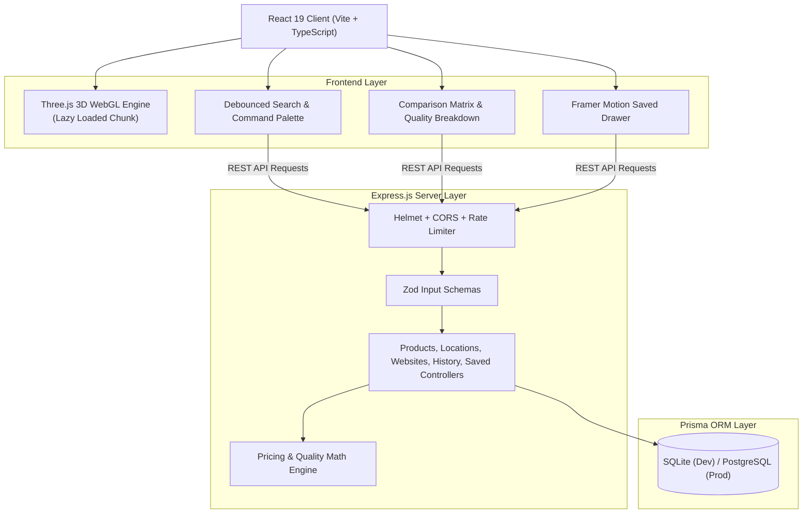
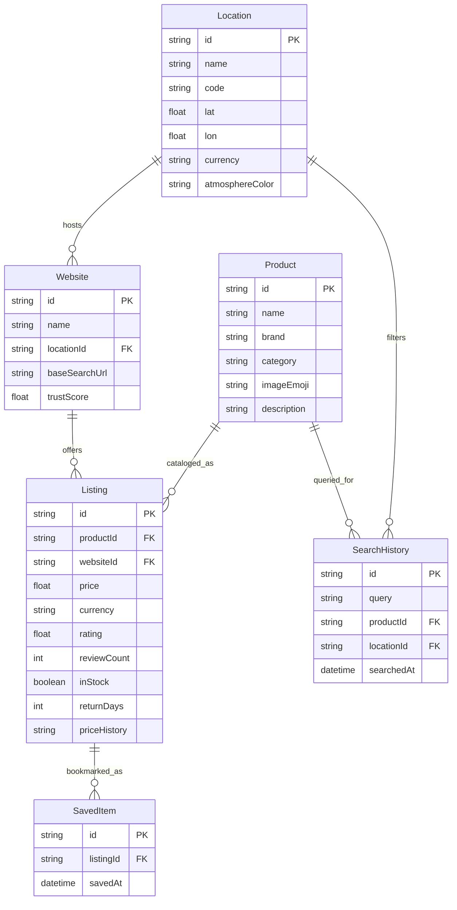

# 🌍 GeoShop: Global Location-Based Product Search & Price-Comparison Platform


**GeoShop** is a production-quality, location-based product discovery and shopping platform comparison platform built for MSc Software Systems / Full-Stack Development. It enables customers to search for any product, visualize worldwide store availability as pins on an interactive **3D rotating Earth globe**, evaluate multi-merchant prices, ratings, verified reviews, and derived Quality Scores across platforms (e.g. Amazon, Flipkart, MediaMarkt, Rakuten), and seamlessly redirect to the original merchant product pages to complete purchases.

GeoShop operates strictly as a **discovery & comparison layer**—it never processes payments or impersonates storefronts.

---

## 🌟 Key Features

1. **Interactive 3D World Globe (Three.js & WebGL)**
   - **Local Photorealistic Textures**: Bundled 2K day, normal/bump, specular, and cloud maps for 100% offline functionality.
   - **Custom Atmospheric Fresnel Shader**: Dynamic atmosphere glow with smooth color shifts matching the selected country (e.g., *Cyber Saffron* for India 🇮🇳, *Cyber Cyan* for USA 🇺🇸, *Sakura Crimson* for Japan 🇯🇵, *Emerald Aurora* for Germany 🇩🇪).
   - **Independent Orbiting Cloud Layer**: Realistic volumetric atmospheric drift.
   - **Accurate Geodesic Mapping**: UV-calibrated spherical coordinates (`latLongToVector3`).
   - **Damped Inertia & Idle Auto-Rotate**: Smooth OrbitControls rotation that pauses on user interaction and auto-resumes after 4 seconds of inactivity.
   - **Gesture Discriminator**: 5px threshold cleanly separates dragging from clicking; 250ms debounce differentiates single-click (fly-to) from double-click (comparison matrix).

2. **Price Pulse & Animated Deal Arcs**
   - **Price Pulse Color Tiers**: Country pins dynamically pulse based on relative price:
     - 🟢 **Green**: Global Best Price / Cheapest ($\le 10\%$ of minimum)
     - 🟡 **Amber**: Mid-tier regional price ($10\% - 30\%$ above minimum)
     - 🔴 **Red**: Higher price / Tariffs ($> 30\%$ above minimum)
   - **Animated Deal Arcs**: Parabolic 3D Bézier curves arching over the globe from the selected country to cheaper destinations with traveling pulse particles and interactive savings tags (e.g. `⚡ Save 17% ($250) in USA 🇺🇸`).
   - **Permanent Legend**: Glassmorphic Price Pulse & Deal Arcs legend anchored to the viewport.

3. **Multi-Store Price & Quality Comparison Engine**
   - **Normalized Multi-Currency Engine**: Compares prices in local currencies (₹ INR, $ USD, £ GBP, € EUR, ¥ JPY, A$ AUD, AED, R$ BRL) alongside standardized USD conversions.
   - **30-Day SVG Price Sparklines**: Historical regional price trends for each merchant listing.
   - **"Best Time to Buy" Advice**: Dynamic hints (`Historical low - buy now`, `Good time to buy`, or `Price is stable`).
   - **Algorithmic Winner Badges**: Flags **Best Price**, **Best Quality**, and **Best Value**.
   - **Side-by-Side Cross-Country Mode**: Compare listings across up to 3 countries simultaneously.

4. **Transparent 5-Factor Quality Index (0-100)**
   - Algorithmic scoring that prevents seller manipulation:
     - **40% Customer Rating Component**: Star ratings normalized to 40 points.
     - **30% Review Volume Component**: Log-scaled review count to reflect statistical confidence.
     - **30% Seller Trust Component**: Historical seller reliability and fulfillment record.
     - **Consumer Rights Shield**: 30-day hassle-free return policy verification.
     - **Anti-Price-Gouging Check**: Flags listings with inflated pricing (>20% above 30-day historical median).

5. **Direct Merchant Redirection**
   - Clicking **BUY / VISIT STORE** triggers celebratory confetti visual feedback and opens the original merchant search URL in a new tab with strict `rel="noopener noreferrer"` protection and demonstration disclaimers.

6. **Search, History & Mission-Control Navigation**
   - **300ms Debounced Search**: Fast search bar with keyboard-navigable autocomplete suggestions (<kbd>↑</kbd>/<kbd>↓</kbd>/<kbd>Enter</kbd>).
   - **Popular Pills**: `iPhone`, `Laptop`, `Headphones`, `Shoes`, `Smart Watch`, `Camera`, `PS5`.
   - **Search-to-Globe Auto-Fly**: Selecting any product maps pins and automatically eases the 3D camera to the cheapest country pin.
   - **Database-Backed History**: Audit trail stored in SQLite/PostgreSQL with re-run, single delete, and clear-all actions.
   - **Command Palette (<kbd>Ctrl+K</kbd>)**: Quick search, country jump, and navigation palette.
   - **Saved Drawer**: Bookmarked listings persisted to database with Framer Motion spring transitions.

---

## 🏗️ Architecture & Technology Stack



### Technology Matrix

| Layer | Technologies | Purpose |
| :--- | :--- | :--- |
| **Frontend Framework** | React 19, TypeScript, Vite | Fast rendering, strict type-safety, rapid HMR |
| **3D Graphics** | Three.js (WebGL), Custom GLSL Shaders, OrbitControls | 60 FPS interactive rotating Earth, pins, Deal Arcs, atmosphere |
| **Styling & Motion** | Tailwind CSS v4, Framer Motion, Lucide Icons, Canvas-Confetti | Glassmorphic dark UI, micro-animations, spring drawers |
| **Backend Runtime** | Node.js, Express.js, TypeScript | REST API architecture, central error handling |
| **Database & ORM** | Prisma ORM (SQLite / PostgreSQL) | Strongly-typed relational data model, automated migrations |
| **Security** | Helmet, express-rate-limit, CORS, Zod validation | HTTP headers hardening, rate limiting, strict payload parsing |
| **Testing** | Vitest (18 passing unit & API tests) | Fast native TypeScript test runner |

---

## 🗄️ Relational Data Model (Mermaid ER Diagram)



---

## ⚡ Quick Start & Installation (< 5 Minutes)

### Prerequisites
- **Node.js**: `v18.0.0` or higher
- **npm**: `v9.0.0` or higher

### 1. Backend Setup & Seeding

```bash
cd backend
npm install
npm run db:generate
npm run db:push
npm run db:seed
npm run dev
```
*Backend runs on `http://localhost:5000` (`/api/health` reports status).*

### 2. Frontend Setup

Open a second terminal window:
```bash
cd frontend
npm install
npm run dev
```
*Frontend application runs on `http://localhost:5173`.*

---

## 🧪 Testing

Run backend unit and integration tests with Vitest:
```bash
cd backend
npm test
```
*Executes 18 tests verifying currency conversion, Quality Index math, Price Pulse tiers, and REST API endpoints.*

---

## 📡 REST API Reference

| Method | Endpoint | Description |
| :--- | :--- | :--- |
| `GET` | `/api/health` | Service health status and phase identifier |
| `GET` | `/api/products` | Retrieve all catalog products |
| `GET` | `/api/products/search?q=...` | Debounced product search with AI discovery analysis |
| `GET` | `/api/products/:id` | Get detailed product specifications |
| `GET` | `/api/products/:id/availability` | Get 3D Globe location pins, lat/lon, and lowest regional prices |
| `GET` | `/api/products/:id/compare?locationId=...` | Side-by-side merchant store listings, sparklines, and quality score |
| `GET` | `/api/locations` | List 8 global countries with atmosphere colors |
| `GET` | `/api/websites` | List supported shopping platforms |
| `GET` | `/api/history` | Retrieve search query audit trail |
| `POST` | `/api/history` | Record a search query |
| `DELETE` | `/api/history/:id` | Delete individual search query |
| `DELETE` | `/api/history` | Clear all search history |
| `GET` | `/api/saved` | Retrieve bookmarked store listings |
| `POST` | `/api/saved` | Save / bookmark a store listing |
| `DELETE` | `/api/saved/:id` | Remove a bookmarked listing |

---

## 🚀 Production Deployment Guide

### Production Deployment (Vercel & Railway)
👉 **See the complete step-by-step guide in [docs/DEPLOYMENT.md](docs/DEPLOYMENT.md)**

1. **Push to GitHub**: Push the repository to GitHub (`git push -u origin main`).
2. **Deploy Backend on Railway**:
   - Create a project on [Railway](https://railway.app), deploy from GitHub, set Root Directory to `/backend`.
   - Add a **PostgreSQL** database service in Railway.
   - Set environment variables (`DATABASE_URL`, `NODE_ENV=production`, `CORS_ORIGIN=*`, `JWT_SECRET`).
   - Run `npm run db:setup` in Railway to initialize tables and populate seed data.
   - Generate a public domain (e.g. `https://geoshop-backend.up.railway.app`).
3. **Deploy Frontend on Vercel**:
   - Import project in [Vercel](https://vercel.com), set Root Directory to `frontend`.
   - Set `VITE_API_BASE_URL` to your Railway domain ending with `/api` (e.g., `https://geoshop-backend.up.railway.app/api`).
   - Click **Deploy**.

---

## 📚 Documentation & Viva Defense Resources

- **[5-Minute Live Viva Demo Script](docs/DEMO_SCRIPT.md)**: Structured walkthrough for live examiner evaluations.
- **[20 Viva Examination Questions & Answers](docs/VIVA_QA.md)**: Detailed technical explanations covering Three.js, shaders, algorithms, and Prisma.
- **[5-Phase Verification Checklist](docs/CHECKLIST.md)**: Complete feature verification matrix.

---

## 📜 Limitations & Future Work

- **Live Affiliate API Webhooks**: Current development uses a seed layer. Production can integrate Amazon Creator API and Flipkart Affiliate API.
- **Real-Time Exchange Rates**: Can connect to open exchange rate APIs (e.g. Open Exchange Rates) for live hourly forex updates.
- **GeoIP Localization**: Auto-detecting customer country via MaxMind GeoIP on first load.

---

## ⚖️ License & Disclaimers

- GeoShop is designed as an educational full-stack capstone project for MSc Software Systems / Full Stack Development.
- All merchant logos and trademarks (Amazon, Flipkart, MediaMarkt, Rakuten, etc.) belong to their respective owners.
