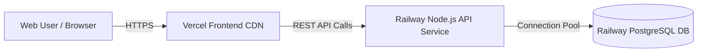

# 🚀 Production Deployment Guide: Railway & Vercel

This guide provides end-to-end instructions for deploying the **GeoShop Global Platform** to production:
- **Backend API & PostgreSQL Database**: Hosted on [Railway](https://railway.app)
- **Frontend SPA**: Hosted on [Vercel](https://vercel.com)
- **Source Code**: Hosted on [GitHub](https://github.com)

---

## 📑 Architecture Overview



---

## 📋 Pre-Deployment Checklist

- [x] Prisma schema configured for **PostgreSQL** (`backend/prisma/schema.prisma`).
- [x] Production build scripts configured with `prisma generate && tsc`.
- [x] CORS middleware updated to support dynamic origin or `*`.
- [x] Health check endpoints active at `/` and `/api/health`.
- [x] Single-Page Application (SPA) routing rewrites added to `vercel.json`.
- [x] Production environment templates created (`.env.example`).
- [x] Git repository initialized and clean initial commit created.

---

## 1️⃣ Step 1: Push Code to GitHub

1. Open your terminal or command prompt.
2. If you haven't created a GitHub repository yet:
   - Go to [github.com/new](https://github.com/new) and create a repository named `geoshop` (public or private).
3. Connect your local git repository to GitHub and push:
   ```bash
   git remote add origin https://github.com/YOUR_GITHUB_USERNAME/geoshop.git
   git branch -M main
   git push -u origin main
   ```
   *(Replace `YOUR_GITHUB_USERNAME` with your actual GitHub username).*

---

## 2️⃣ Step 2: Deploy Backend & Database on Railway

### 2.1 Create Railway Project
1. Go to [railway.app](https://railway.app) and log in with your GitHub account.
2. Click **"+ New Project"**.
3. Select **"Deploy from GitHub repo"** and choose your `geoshop` repository.

### 2.2 Add PostgreSQL Database
1. Inside your Railway project canvas, click **"+ Create"** (or **"+ New"**).
2. Select **"Database"** ➔ **"Add PostgreSQL"**.
3. Railway will provision a PostgreSQL instance and automatically generate a `DATABASE_URL` variable.

### 2.3 Configure the Backend Service
1. Click on the deployed GitHub service block in Railway.
2. Go to the **"Settings"** tab:
   - **Root Directory**: Change this to `/backend` (so Railway builds inside the backend directory).
   - **Build Command**: `npm run build` (or leave default to use `railway.json`).
   - **Start Command**: `npm start`.
3. Go to the **"Variables"** tab and add the following environment variables:
   - `DATABASE_URL`: Click **"Add Reference"** and select `Postgres.DATABASE_URL` (or paste the connection string from your Postgres service).
   - `NODE_ENV`: `production`
   - `CORS_ORIGIN`: `*` (or your Vercel URL once generated, e.g. `https://your-geoshop.vercel.app`)
   - `JWT_SECRET`: Any secure string (e.g. `geoshop_super_secret_jwt_key_2026_production_ready`)
4. Go to the **"Networking"** tab:
   - Under **Public Networking**, click **"Generate Domain"**.
   - Copy the generated domain (e.g., `https://geoshop-backend-production.up.railway.app`).

### 2.4 Seed the PostgreSQL Database
Once Railway deploys the backend, run the database migrations and seed script:
1. In the Railway backend service, go to the **"Deployments"** or **"Settings"** tab and open the **"CLI"** / **"Command"** terminal (or install Railway CLI locally using `npm i -g @railway/cli`):
2. Execute the setup command:
   ```bash
   npm run db:setup
   ```
   *(This runs `prisma db push` to generate all tables, followed by `tsx src/prisma/seed.ts` to populate all 12 countries, 5 stores per country, and hundreds of global products).*
3. Verify by visiting `https://your-railway-url.up.railway.app/` in your browser. You should see:
   ```json
   {
     "success": true,
     "service": "GeoShop Backend API",
     "version": "1.0.0",
     "status": "healthy"
   }
   ```

---

## 3️⃣ Step 3: Deploy Frontend on Vercel

### 3.1 Import Project into Vercel
1. Go to [vercel.com](https://vercel.com) and log in with GitHub.
2. Click **"Add New..."** ➔ **"Project"**.
3. Select your `geoshop` repository from the list and click **"Import"**.

### 3.2 Configure Project Settings
1. **Project Name**: `geoshop` (or your preferred name).
2. **Framework Preset**: `Vite` (automatically detected).
3. **Root Directory**: Click **Edit** and set it to:
   ```
   frontend
   ```
4. **Build & Development Settings**:
   - Build Command: `npm run build`
   - Output Directory: `dist`
   - Install Command: `npm install`

### 3.3 Set Environment Variables
Under the **"Environment Variables"** section, add:
- **Key**: `VITE_API_BASE_URL`
- **Value**: `https://your-railway-backend-url.up.railway.app/api`
  *(⚠️ Make sure to append `/api` at the end of your Railway URL).*

### 3.4 Deploy
1. Click **"Deploy"**.
2. Vercel will build the frontend and provide your live URL (e.g., `https://geoshop.vercel.app`).

---

## 4️⃣ Step 4: Final Verification

1. Open your live Vercel URL in your browser.
2. Test the following features:
   - **3D World Globe**: Verify the Earth rotates smoothly with the Sage & Cream atmosphere glow.
   - **Product Search**: Type `iPhone`, `Laptop`, or `Sony` and press Enter.
   - **Price Comparison Matrix**: Verify prices load from the Railway backend for all 10+ countries.
   - **Deal Arcs & Price Pulse**: Confirm savings curves and color-coded pulse pins render properly.
   - **Direct Store Links**: Click "Visit Store" to confirm redirection and celebratory visual confetti.
   - **Search History**: Confirm recent queries persist in the PostgreSQL database.

---

## 🛠️ Troubleshooting

| Issue | Cause | Solution |
| :--- | :--- | :--- |
| **CORS error in browser console** | Frontend domain blocked by backend | Set `CORS_ORIGIN=*` in Railway Variables, or add your specific Vercel URL. |
| **API returns 404** | Missing `/api` suffix | Ensure `VITE_API_BASE_URL` on Vercel ends with `/api` (e.g. `https://xxx.up.railway.app/api`). |
| **500 Internal Server Error on API** | Database tables missing | Run `npm run db:setup` in Railway terminal to apply `prisma db push` and seed data. |
| **404 on page refresh on Vercel** | Missing SPA rewrites | Ensure `frontend/vercel.json` exists with rewrites pointing to `/index.html` (already configured). |
